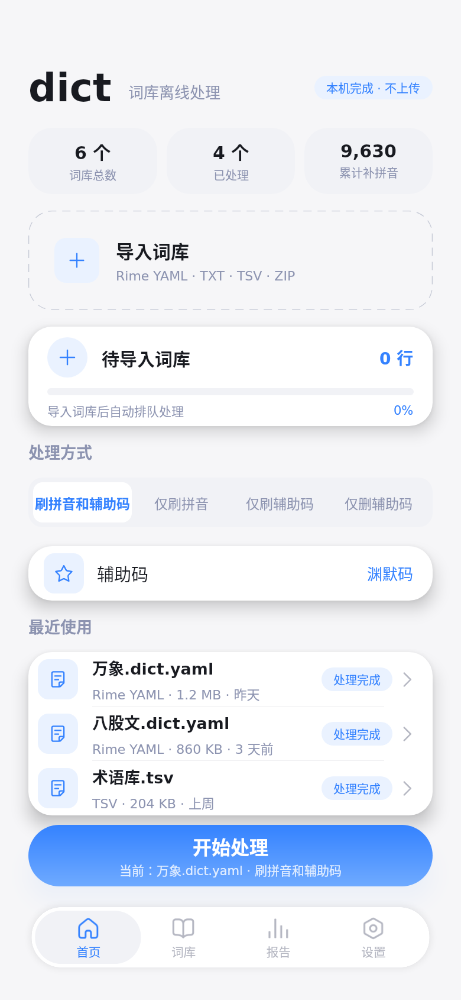
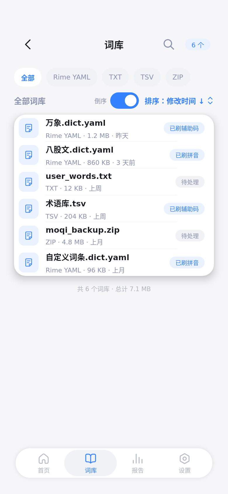
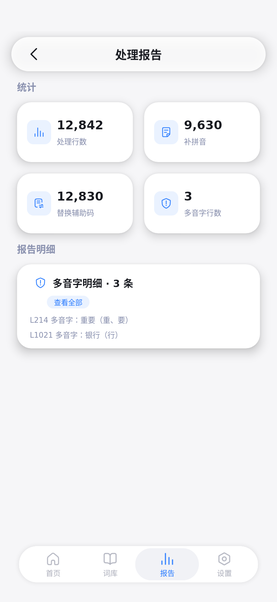
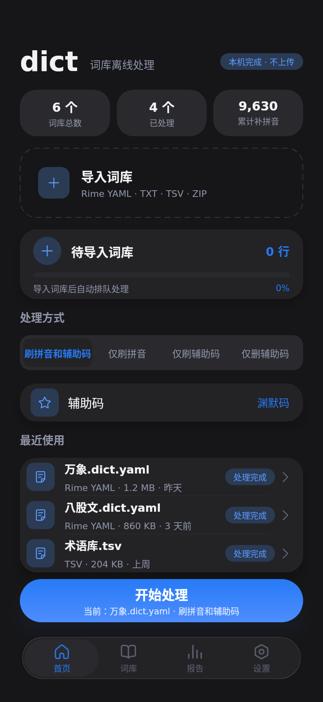
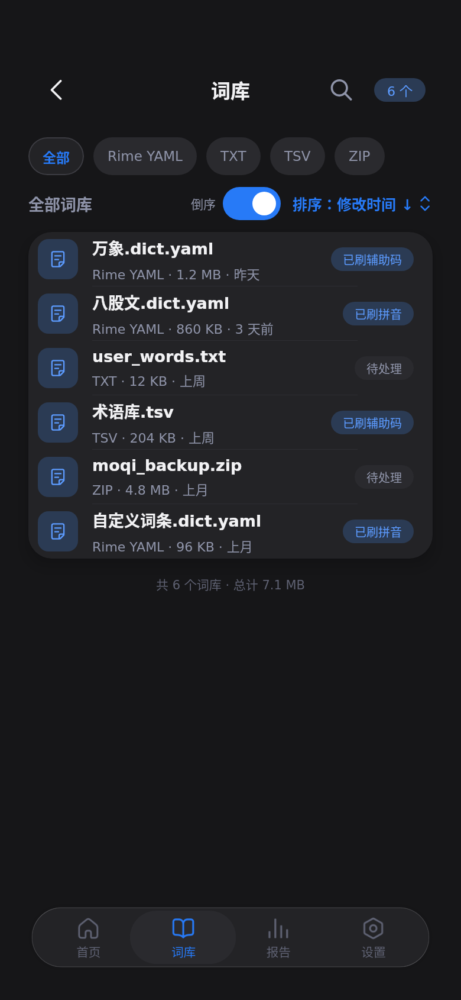
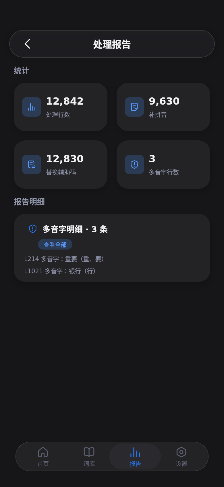

<div align="center">


# kirakira

基于 Kotlin、Compose Multiplatform 与 Miuix 的离线词库处理工具。

[](https://github.com/LikeLucia/dict/releases/latest)
[](https://github.com/LikeLucia/dict/actions/workflows/Android-APK.yml)
[](#下载)
[](LICENSE)

[下载](https://github.com/LikeLucia/dict/releases/latest) · [构建说明](#构建) · [开放源代码许可](app/src/main/assets/THIRD_PARTY_NOTICES.md)

</div>

本项目支持导入 Rime YAML / TXT / ZIP 词库，在本机完成拼音与辅助码处理并导出结果，词库数据不会上传。项目为纯 AI 产物。

## 下载

从 [Releases](https://github.com/LikeLucia/dict/releases/latest) 下载最新 APK。支持 **Android 7.0 及以上的 ARM64 设备**。

- 包名：`kirakira.dokidoki`。版本号记录在 `version.properties`，正式版本使用三段式 `MAJOR.MINOR.PATCH`。
- 每个正式版本由 GitHub Actions 自动构建；Release 签名由仓库 Secrets 提供。
- 从旧版 1.1.0（WebView 版本）升级时，因签名不同，需要先备份数据并卸载旧版。

## 界面预览

以下为应用界面预览（浅色 / 深色）。

<table>
  <tr>
    <th>首页</th>
    <th>词库</th>
    <th>报告</th>
  </tr>
  <tr>
    <td></td>
    <td></td>
    <td></td>
  </tr>
  <tr>
    <td></td>
    <td></td>
    <td></td>
  </tr>
</table>

## 功能

- **导入与队列**：通过系统 SAF 单选或多选导入，自动排队处理；首页展示处理进度、预计时长与队列状态，支持开始和取消。
- **处理方式**：刷拼音和辅助码、仅刷拼音、仅刷辅助码、仅删辅助码。
- **辅助码**：内置渊默码、kirakira（自用）、自然码、小鹤、墨奇五套码表，支持固定分隔符和替换已有辅助码；码表可含一字多码（如 `sl,af,al`），按上游顺序输出。
- **Rime 兼容**：`sort: original` 的词库按原顺序处理、不补权重，并在“刷拼音和辅助码”时自动跳过辅助码、只刷拼音；中英混排词条只处理汉字，英文与数字段原样保留，写入第二列时英文转小写。
- **处理设置**：可配置拼音声调、补充权重、替换已有拼音、输出分隔符、输入编码（UTF-8 / GB18030）、词语列、拼音列、导出目录及同名文件策略。
- **词库管理**：支持搜索、类型筛选、按修改时间 / 文件大小 / 文件名排序及倒序；长按进入多选，可批量导出或删除。
- **处理报告**：统计处理行数、补拼音、替换辅助码及多音字行数；提供文件列表与多音字详情页，支持按文件名、词语、读音或行号搜索。
- **导出**：支持导出到 Download 或自定义 SAF 目录，同名文件可覆盖或自动加序号。单文件、单输出且无多音字的结果会自动导出，其余结果可在词库页手动导出。
- **会话恢复**：导入记录、待处理文件和报告保存在应用私有目录，重启后恢复，不会自动续跑原队列。
- **主题与交互**：浅色 / 深色主题，使用 Miuix 组件、开关、进度条、列表弹层和页面转场动效。

## 构建

环境要求：JDK 17、Android SDK Platform 37.2、Build-Tools 37.0.0。在项目根目录创建 `local.properties` 并配置 `sdk.dir`。

```bash
./gradlew :app:assembleDebug
```

产物：`app/build/outputs/apk/debug/app-debug.apk`。

Gradle 通过 `RELEASE_KEYSTORE_PATH`、`RELEASE_STORE_PASSWORD`、`RELEASE_KEY_ALIAS`、`RELEASE_KEY_PASSWORD` 环境变量读取签名配置。未提供这些环境变量时，Release 构建回退到 debug 签名，仅用于调试。

## 工程结构

```
app/src/main/java/kirakira/dokidoki/
├── MainActivity.kt          # 应用入口、ViewModel 创建
├── App.kt                   # Tab 导航、文件选择、导出、弹层宿主
├── data/
│   ├── Model.kt             # 数据模型与处理接口
│   ├── MainViewModel.kt     # 状态管理、处理队列、会话恢复
│   ├── JsProcessingEngine.kt# QuickJS 处理引擎
│   ├── AuxTables.kt         # 辅助码表加载
│   ├── ThemeStore.kt        # 主题与处理设置持久化
│   ├── ExportStore.kt       # 文件导出与 ZIP 输出
│   └── ExportNaming.kt      # 导出命名与类型处理
└── ui/
    ├── theme/DictTheme.kt   # 双主题与 MiuixTheme 映射
    ├── components/Common.kt # 通用组件
    ├── components/FlowLightBackground.kt # 关于页流光渐变背景（移植自 c001apk）
    └── screens/             # Home / Lib / Settings / Report / AmbiguityDetail / About / SourceLicense
```

处理资源位于 `app/src/main/assets/`：

- `pinyin-pro.js`：pinyin-pro 3.27.0（MIT）
- `dict_engine.js`：离线词库处理脚本，包含 CRC / ZIP、Rime columns、TXT 与权重处理
- `aux_tables.tsv.deflate`：墨奇 / 自然码 / 小鹤 / 渊默码 / kirakira 五套主码表
- `zi_weights.json.deflate`：多音字读音权重表
- `THIRD_PARTY_NOTICES.md`：第三方来源与许可证索引

## 版本说明

- namespace 与 applicationId：`kirakira.dokidoki`
- versionName 与 versionCode 记录在 `version.properties`；versionName 为三段式 `MAJOR.MINOR.PATCH`，Release 发布时递增末段（2.1.1 → 2.1.2，末段到 9 后进位为 2.4.0），versionCode 同时递增（否则同 code 的新包无法覆盖安装）；CI 构建只递增 versionCode。
- Release 签名由 GitHub Actions 使用仓库 Secrets 完成。

## 参与贡献

欢迎提交 Pull Request。每个 PR 尽量只处理一个问题，说明改动目的和测试方式。移植上游代码时请注明来源与提交，保留原有版权和许可声明。

## 文档

- [开放源代码许可与来源说明](app/src/main/assets/THIRD_PARTY_NOTICES.md)
- [项目许可证](LICENSE)

## 致谢

- [KiritoXDone/c001apk](https://github.com/KiritoXDone/c001apk)：界面、导航与模糊玻璃效果的参考及部分移植来源（AGPL-3.0）。
- [boxproxy/boxproxy](https://github.com/boxproxy/boxproxy)：渐进模糊与标签材质实现参考（GPL-3.0）。
- [YuKongA/Mishka](https://github.com/YuKongA/Mishka)：固定顶栏滚动页与玻璃底栏参数参考（GPL-3.0）。
- [compose-miuix-ui/miuix](https://github.com/compose-miuix-ui/miuix)：界面组件、图标与主题组件（Apache-2.0）。
- [zh-lx/pinyin-pro](https://github.com/zh-lx/pinyin-pro)：离线拼音引擎（MIT）。
- [amzxyz/rime-wanxiang](https://github.com/amzxyz/rime-wanxiang)：万象码表与辅助码数据来源。
- [yuanz-12/momo](https://github.com/yuanz-12/momo)：渊默辅助码表来源。
- [LikeLucia/kirakira](https://github.com/LikeLucia/kirakira)：kirakira 辅助码表来源。
- [bellard/quickjs](https://github.com/bellard/quickjs) 与 [cashapp/quickjs-java](https://github.com/cashapp/quickjs-java)：离线处理引擎与 Android 绑定。

## 许可

项目采用 [GNU Affero General Public License v3.0](LICENSE)。第三方代码、SDK、码表与素材遵循各自许可，详见[开放源代码许可与来源说明](app/src/main/assets/THIRD_PARTY_NOTICES.md)。
